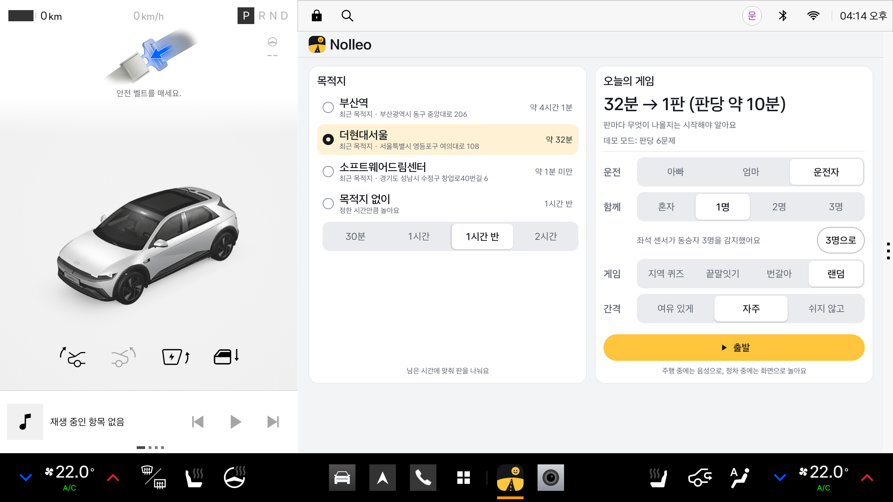
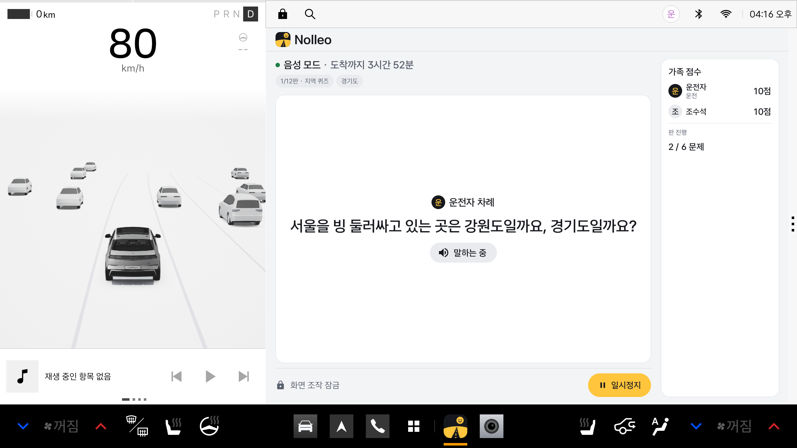
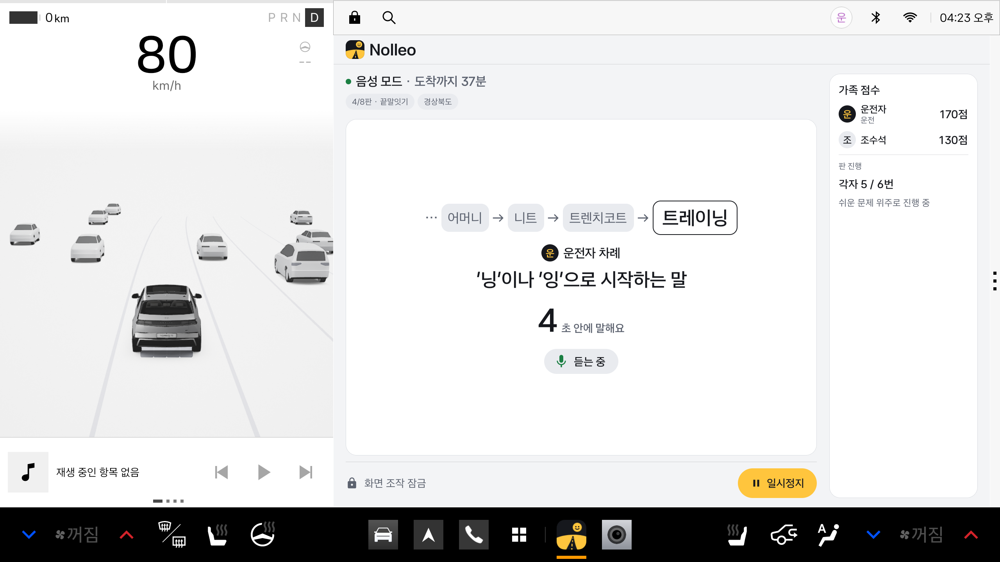
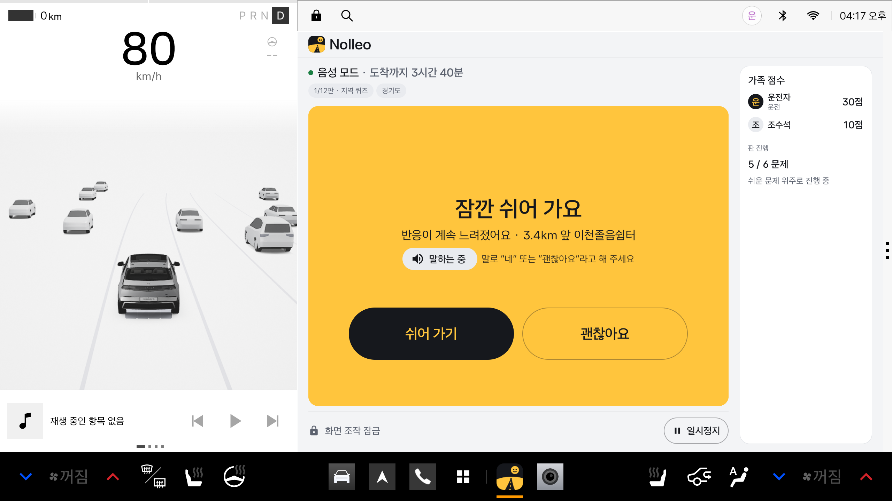
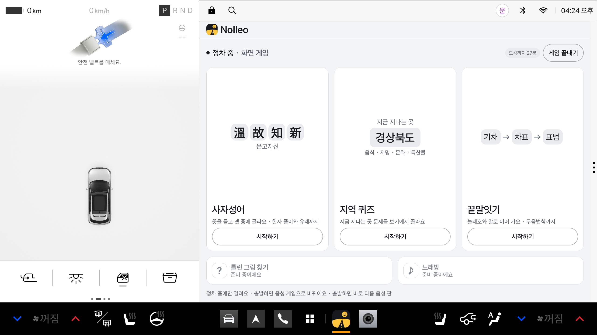
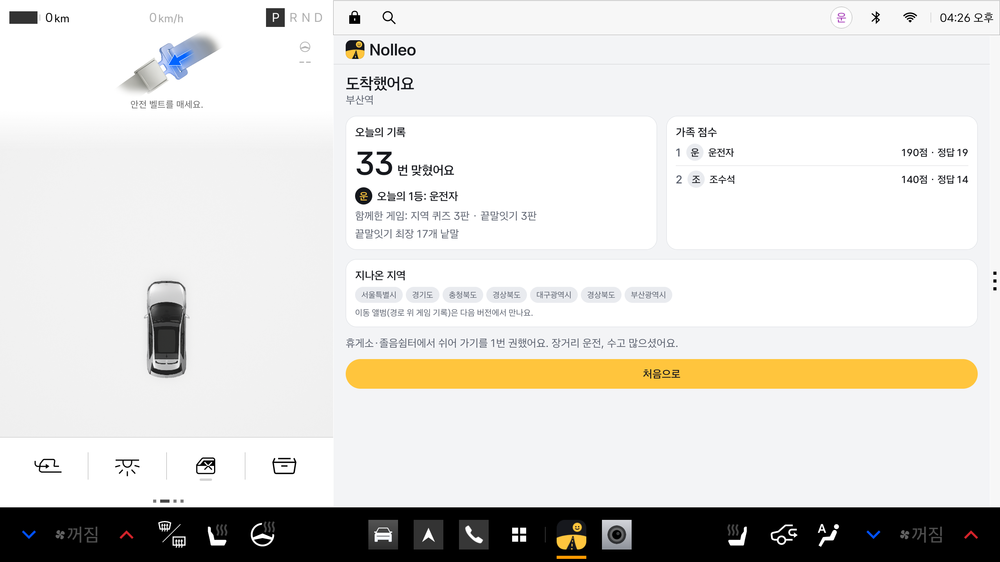
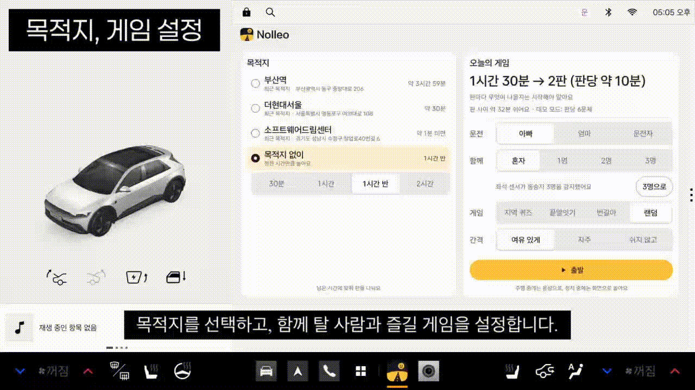

# 놀레오 (Nolleo)

> **가는 길이 놀이가 되는 앱** — **놀레오(Nolleo)** 는 지루한 이동시간에 즐거움을 더해 행복한 이동이 될 수 있게 도와주는 게임 서비스로, 졸음 방지까지 가능한 차량용 엔터테인먼트 앱입니다.

> **운전자까지 한 판에 끼는 차 안 가족 게임** — 주행 중에는 말로, 멈추면 화면으로. 기어 · 남은 시간 · 지나는 지역 · 길 안내에 맞춰 게임이 멈추고 바뀌며, 운전자의 답이 느려지면 경로 위 쉼터를 먼저 권합니다.

팀 **돈도아연** · 현대자동차그룹 차량용 앱 개발 공모전 2026 출품작 · 버전 1.0.0 (versionCode 1)

## 요약

| 항목 | 내용 |
|---|---| 
| **앱 한 줄 소개** | **놀레오(Nolleo)** 는 지루한 이동시간에 즐거움을 더해 행복한 이동이 될 수 있게 도와주는 게임 서비스로, 졸음 방지까지 가능한 차량용 엔터테인먼트 앱입니다. |
| **APK 위치** | [`apk/돈도아연_놀레오_release.apk`](apk/돈도아연_놀레오_release.apk) — release 빌드(서명됨, `debuggable=false`), 약 24 MB |
| **에뮬레이터 버전** | **Pleos Connect Emulator v2.1.0** (빌드 `RELEASE.release_connect_v2.1.0`) · Android 14 (API 34) Automotive · x86_64 |
| **화면 규격** | **2560 × 1440 (가로)** · 160 dpi · AVD RAM 4 GB · **cold boot** |
| **실행 방법** | [§2 실행 방법](#2-실행-방법) — `adb install` 한 줄 + Virtual Console 로 기어 P/D |
| **테스트 환경 · 필요한 설정** | [§3 테스트 환경 및 필요한 설정](#3-테스트-환경-및-필요한-설정) — 권한 2개 허용, 마이크 없이도 시연 가능(대본 응답) |
| **시연 영상** | [YouTube](https://youtu.be/KZevBav97wQ) · 저장소 파일 [`video/Demo_video.mp4`](video/Demo_video.mp4) — 3분 26초 · 1920×1080 · 소리 포함 · 장면별 시작 시각은 [아래 시연 영상](#5-시연-영상) |

**주요 기능** — 자세한 내용은 [§6 주요 기능](#6-주요-기능)
- **운전자도 같은 판에** — 놀레오가 차례를 불러 주면 운전자와 동승자가 말로 답하고, 끝말잇기에는 놀레오도 참가자로 낍니다. 운전자는 화면을 보지 않습니다.
- **주행 중엔 음성, 정차 중엔 화면** — 기어 D 면 지역 퀴즈 · 끝말잇기를 말로, P 면 사자성어 · 지역 퀴즈 · 끝말잇기를 화면으로 합니다.
- **여정에 맞춘 판 나누기** — 내비의 남은 시간과 게임 간격으로 판 수를 정하고, 지역 퀴즈는 지금 지나는 시/도의 문제를 냅니다.
- **운전이 먼저** — 내비 안내 지점 · 통화 · 음성 비서가 오면 멈췄다가 같은 문제부터 다시 합니다.
- **졸음 케어** — 답이 평소보다 느려지면 말을 걸고, 계속 느리면 내비 경로 위 휴게소 · 졸음쉼터를 권합니다.
- **내비와 나란히, 도착하면 요약** — 내비 최근 목적지로 바로 출발하고, 3분할에서는 조수석 쪽 창에 자리 잡으며, 도착하면 점수와 지나온 지역을 정리합니다.

## 앱 화면

<table>
  <tr>
    <td width="50%"><b>홈: 목적지, 운전자, 게임, 판 간격 설정</b></td>
    <td width="50%"><b>주행 중 음성 모드: 지역 퀴즈와 가족 점수</b></td>
  </tr>
  <tr>
    <td></td>
    <td></td>
  </tr>
  <tr>
    <td><b>주행 중 끝말잇기: 이어진 낱말 줄</b> </td>
    <td><b>졸음 케어 2단계: 경로 위 졸음쉼터 권유</b> </td>
  </tr>
  <tr>
    <td></td>
    <td></td>
  </tr>
   <tr>
    <td><b>정차 중: 화면 게임 목록</b></td>
    <td><b>도착 요약: 오늘의 기록과 가족 점수</b></td>
  </tr>
  <tr>
    <td></td>
    <td></td>
  </tr>
</table>

## 빠른 시연 순서

README 만 보고 처음부터 끝까지 돌려 보는 순서입니다(에뮬레이터 준비는 [§2.1](#21-에뮬레이터-준비)). 에뮬레이터는 차량이 움직이지 않고 마이크가 꺼져 있어 **시뮬레이션 여정 + 대본 응답**으로 진행합니다([§3.3](#33-실제-sdk-와-시뮬레이션)).

| # | 조작 (Virtual Console · 디버그 패널) | 앱에서 확인할 것 |
|---|---|---|
| 1 | `adb install -r apk/돈도아연_놀레오_release.apk` → `adb forward tcp:8088 tcp:8088` → 브라우저로 http://127.0.0.1:8088/ (Virtual Console) | 설치 `Success`, Virtual Console 화면 |
| 2 | 앱 목록에서 **놀레오** 실행 → 권한 2개 **허용**(차량 속도 · 차량 위치) | 홈: **목적지** 카드(내비 최근 목적지 · 목적지 없이)와 **오늘의 게임** 카드 |
| 3 | 왼쪽 위 **Nolleo** 제목을 길게 눌러 디버그 패널 → 데모 모드 **켜짐** · 여정 **시뮬**(시뮬 경로 **서울 → 부산**) · 응답 입력 **대본 normal** → **닫기** | 홈 목적지 맨 위에 `서울 → 부산 · 시뮬 여정`, 오늘의 게임에 `데모 모드: 판당 6문제` |
| 4 | 홈에서 `서울 → 부산` 고르고 함께 **1명** → **출발** (기어 P 그대로) | `4시간 10분 → n판` 으로 세션 시작, 정차 중이라 화면 게임 목록 |
| 5 | Virtual Console **Motion > Gear Selection: D** | 음성 모드: 판 소개 → 문제를 소리로 읽고 대본이 답함 → 판정 줄 · 가족 점수 · `n / 6 문제` · `화면 조작 잠금`, 남은 시간이 30배로 줄어듦 |
| 6 | **Gear Selection: P** → 목록에서 **사자성어** 시작하기 | 진행 중인 차례를 마친 뒤 화면 게임 목록 → 뜻을 듣고 보기 4개 중 터치, 맞히면 한자 훈·음과 유래 |
| 7 | 패널 응답 입력 **대본 sleepy** → 닫기 → **Gear Selection: D** | 운전자 답이 점점 느려지면 1단계 말 걸기 띠 `잠깐 쉬어 갈까요?` → 이어서 2단계 `잠깐 쉬어 가요 · n km 앞 ○○졸음쉼터`(말로 네 / 괜찮아요, 또는 큰 버튼). 바로 보려면 패널 **2단계 시험 (다음 운전자 답 뒤)** |

---

## 1. APK 위치

| 파일 | 설명 |
|---|---|
| [`apk/돈도아연_놀레오_release.apk`](apk/돈도아연_놀레오_release.apk) | 실행 가능한 **release** 빌드 (서명됨, `debuggable=false`, R8 최적화) · 약 24 MB · 패키지 `com.nolleo.app` · minSdk 28 / targetSdk 37 |

---

## 2. 실행 방법

### 2.1 에뮬레이터 준비
1. **Pleos Connect Emulator 2.1.0** 설치 — Pleos 공식 가이드 [SDK · 에뮬레이터 설정](https://document.pleos.ai/docs/connect/guide/getting-started/application-development/setup-connect-sdk-emulator)을 따릅니다(Android Studio SDK Manager 에 Pleos 시스템 이미지 주소를 추가해 설치)
2. AVD 생성: **Device Manager > Create device** → Automotive **Pleos Connect v2.1.0**(2560 × 1440, 160 dpi) → 시스템 이미지 **Pleos Connect v2.1.0 APIs**(API 34), RAM **4 GB**, 부팅 **Cold**(Startup > Default boot) — Quick boot 면 차량 HAL(VHAL)을 쓸 수 없습니다
3. AVD 를 켜고 `adb devices` 로 연결 확인

### 2.2 설치
```bash
# 방법 A — 저장소의 release APK (권장)
adb install -r apk/돈도아연_놀레오_release.apk

# 방법 B — 소스에서 빌드 (gradlew 실행에 JDK 17 이상 필요, 빌드용 JDK 는 Gradle 이 자동으로 받음)
./gradlew installDebug          # Windows: gradlew.bat installDebug
```

### 2.3 차량 상태 바꾸기 (Virtual Console)
```bash
adb forward tcp:8088 tcp:8088   # 브라우저로 http://127.0.0.1:8088/ 열기
```
- **Motion > Gear Selection**: **D** → 음성 게임, **P** → 진행 중인 차례를 마친 뒤 정차 중 화면 게임 목록
- **Motion > Brake Pedal**: 신호대기(STOPPED) 보조 신호
- **Convenience > Seat Occupancy**: 동승자 수 제안용(에뮬레이터는 착좌 값이 고정 — [§3.3](#33-실제-sdk-와-시뮬레이션))

### 2.4 처음 써 보기
1. 앱을 열고 권한 2개 허용: **차량 속도**(`android.car.permission.CAR_SPEED`), **차량 위치**(`pleos.car.permission.FUSED_LOCATION`)
2. **홈**에서 목적지(내비 **최근 목적지** · 길 안내 중이면 **현재 경로** · **목적지 없이** 30분~2시간), 운전자, 함께 타는 사람, 게임, 판 간격을 고르고 **출발**
3. 기어 **D** → 음성 게임. 기어 **P** → 화면 게임 목록(사자성어 · 지역 퀴즈 · 끝말잇기)
4. 그만하려면 음성 화면의 일시정지 → **게임 끝내기**(정차 중에는 게임 목록 머리 줄). 점수가 있으면 요약 화면

**에뮬레이터에서 바로 시연하려면** — 에뮬레이터 차량은 움직이지 않고 마이크도 기본으로 꺼져 있으니, 왼쪽 위 **"Nolleo" 제목을 길게 눌러 디버그 패널**을 열고:
- 여정 **시뮬** + 시뮬 경로 **서울 → 부산**: 남은 시간이 30배로 흐르고 지나는 지역이 바뀝니다(주행 중에만)
- 응답 입력 **대본 normal**: 사람 대신 미리 정한 답이 들어옵니다(**대본 sleepy** 는 점점 느려져 졸음 케어가 걸림, **대본 film** 은 시연 영상 촬영 순서용)
- 데모 모드 **켜짐**: 판당 6문제(끝말잇기는 사람마다 6번), 졸음 케어 대기 시간 단축
- 그 밖에 TBT 분기점 300m(길 안내 일시정지 시험), 남은 5분으로(도착 요약), 내비 남은 시간으로(시뮬 여정을 내비 길 안내에 맞춤), 2단계 시험(쉼터 권유 — 다음 답 뒤 / 다음 느린 답 뒤) 버튼
- 패널을 여는 동안에는 게임과 여정 시간이 멈추고, 닫으면 같은 문제부터 이어집니다(패널 모드 칸에서 끌 수 있음)

---

## 3. 테스트 환경 및 필요한 설정

### 3.1 테스트 환경

| 항목 | 값 |
|---|---|
| 에뮬레이터 | **Pleos Connect Emulator v2.1.0** — AVD `Pleos_Connect_v2.1.0`, 빌드 `RELEASE.release_connect_v2.1.0`, Android 14 / API 34 Automotive, x86_64 (Android Emulator 37.2.13) |
| 화면 | **2560 × 1440 가로**, 160 dpi (1 dp = 1 px) · Driving view + 앱 영역(1창 또는 내비와 3분할) |
| AVD 설정 | RAM 4 GB, **cold boot** |
| 개발 PC | Windows 11 |
| 빌드 | Gradle 9.6.0 · AGP 9.5.0 (built-in Kotlin 2.2.10) · compileSdk 37 · minSdk 28 · Java 11 target · Jetpack Compose (BOM 2025.09.00) + Material3 |
| 확인 범위 | 에뮬레이터에서만 확인(실차 미확인). 단위 테스트 237개, lint 오류 0 |

### 3.2 필요한 설정

| 설정 | 필요 여부 | 내용 |
|---|---|---|
| 런타임 권한 | **필수** | `CAR_SPEED`(차량 속도), `FUSED_LOCATION`(차량 위치 — `FusedLocation.isSupported()` 일 때만 요청). `RECORD_AUDIO` 는 Android 폴백 인식기가 쓰일 때만 요청 |
| Virtual Console | **필수**(기어 조작) | `adb forward tcp:8088 tcp:8088` → http://127.0.0.1:8088/ |
| 마이크 | 선택 | 실제 음성으로 답하려면 에뮬레이터 **Extended Controls(⋯) > Microphone > "Virtual microphone uses host audio input"** 를 켜고 디버그 패널 응답 입력 **마이크**. 마이크 없이 시연하려면 **대본 normal / sleepy** (TTS 는 실제 Pleos 음성 그대로) |
| 국내 위치 | 선택 | 실제 위치로 지역을 정하려면 `adb emu geo fix 126.9780 37.5665`(서울 시청, 경도 먼저). 없으면 내비 주소 → 시뮬 경로 순으로 정합니다 |
| `local.properties` | 선택 | `PLEOS_CLIENT_ID`, `PLEOS_CLIENT_SECRET` — 있으면 TTS/STT `Mode.HYBRID`, 없으면 `Mode.ON_DEVICE`(이 제출본은 **ON_DEVICE**) |
| release 서명 | 선택(직접 빌드 때) | `RELEASE_STORE_FILE`, `RELEASE_STORE_PASSWORD`, `RELEASE_KEY_ALIAS`, `RELEASE_KEY_PASSWORD` — 없으면 debug 키로 서명 |

### 3.3 실제 SDK 와 시뮬레이션

기능은 모두 실제 SDK 를 호출합니다. Pleos SDK 5종과, 기어·속도처럼 표준 차량 데이터를 읽는 안드로이드 표준 AAOS Car API 를 씁니다(Pleos 개발 가이드 규칙 — 표준 데이터는 AAOS, OEM 데이터는 Pleos SDK).

> **TBT (Turn-By-Turn)**: 내비가 다음 안내(좌회전·IC 진입·휴게소 진입·졸음쉼터 …)를 순서대로 알려 주는 목록(NaviHelper `onTBTInfo`).

| SDK | 쓴 API · 데이터 | 놀레오에서 하는 일 |
|---|---|---|
| **AAOS Car API** `CarPropertyManager` | `GEAR_SELECTION` · `PERF_VEHICLE_SPEED` · `PARKING_BRAKE_ON` (`registerCallback`) | 주행/정차 판정 → 음성 게임 ↔ 화면 게임 전환 |
| **AAOS Car API** `CarUxRestrictionsManager` | 주행 규제 (`registerListener` → `isRequiresDistractionOptimization` · `activeRestrictions`) | 규제 중에는 화면 게임 금지 · 설정 잠금 |
| **Pleos Vehicle** 2.3.2 | 브레이크 페달 `getBrake()` (`checkBrakePedalStatusCapabilities` → `registerBrakePedalStatus`) | 신호대기(STOPPED) 판정 보조 |
| **Pleos Vehicle** 2.3.2 | 좌석 착좌 `getSeat()` (`checkSeatOccupancyCapabilities` → `registerSeatOccupancy`) | 홈에서 함께 타는 사람 수 제안 |
| **NaviHelper** 3.0.5 | 길 안내 `requestRoute` · `onRouteStarted` · `onDestinationInfo` / `onDrivingInfo`(남은 시간·거리) | 남은 시간에 맞춰 판 수 정하기 · 크게 바뀌면 다시 계획 · 도착 요약 |
| **NaviHelper** 3.0.5 | 최근 목적지·예상 시간 `getRecentDestinationInfo` · `requestTrip` → `onTripInfo` | 홈 목적지 목록(길 안내 없이 예상 시간 표시) |
| **NaviHelper** 3.0.5 | TBT `onTBTInfo` · `getTBTInfo` | 분기점·회전 안내 때 게임 일시정지 · 경로 위 휴게소·졸음쉼터(`TURN_ENTER_SERVICEAREA` · `TURN_RESTAREA`) 찾기 |
| **NaviHelper** 3.0.5 | 현재 위치 주소 `getCurrentLocationInfo` | 위치로 지역을 못 정할 때 지역 퀴즈의 지역 대신 정하기 |
| **FusedLocation** 1.1.3 | `isSupported` · `registerFusedLocationCallback` · `getLastKnownLocation` | 지역 퀴즈 지역(지금 지나는 시/도) · 진행 방향(상·하행 가르기) |
| **FusedLocation** 1.1.3 | 근접 알림 `addProximityAlert` (반경 300 m) | 권한 쉼터에 도착했는지 감지 |
| **TextToSpeech** 3.3.1 | `speak` (`Mode.ON_DEVICE`) | 문제·결과·쉼터 권유 읽기 |
| **SpeechToText** 3.3.1 | `request` → 인식 결과 콜백 (`Mode.ON_DEVICE`) | 답 인식 · 응답 시간 측정(졸음 케어) · 쉬어 가기 "네/아니요" |

**에뮬레이터에서 확인할 때** (Pleos Connect Emulator v2.1.0 — 위 API 는 모두 호출·수신을 확인했고, 다른 점만 적었습니다)
- **좌석 착좌**: 에뮬레이터가 동승석 4곳을 늘 착좌로 보내 늘 "3명"(앱이 고를 수 있는 최대)을 제안합니다.
- **길 안내**: 에뮬레이터 차량이 움직이지 않아 남은 시간·TBT 가 그대로입니다 → 시연은 **시뮬레이션 여정**(남은 시간이 30배로 줄고 지나는 지역이 바뀜, 디버그 패널에서 켬 — [§2.4](#24-처음-써-보기)). TBT 쉼 장소는 실제로 받습니다(예: 부산역 경로 TBT 54개 중 쉼 장소 22곳 — 휴게소 9 · 졸음쉼터 13, 가장 가까운 곳 용인졸음쉼터 18.1 km).
- **위치**: 기본 좌표로는 국내 지역이 안 나와 `adb emu geo fix <경도> <위도>` 로 국내 좌표를 넣습니다. 쉼터 도착 감지도 쉼터 좌표로 옮겨 확인합니다. 시뮬레이션 여정 중에는 시뮬 경로의 지역이 우선입니다.
- **음성 인식**: 호스트 마이크를 켜야 인식합니다([§3.2](#32-필요한-설정)). 끄면 8초 무응답 → 시연은 **대본 응답**(미리 정한 답, TTS 는 실제 Pleos 음성).
- **주행 규제**: 기어 D 에서 `requiresDO=true, active=80(NO_VIDEO+NO_SETUP)` 을 받습니다. `driving_regulation on/off` 셸 명령은 이 에뮬레이터에 없어(`hmg_car_service` 없음) 기어 D 로 확인했습니다.

**쓰지 않은 것**: NaviHelper `addWaypoint`(좌표 경유지) — 좌표로 넣으면 고속도로 옆 일반 도로로 우회 경로가 생겨, 경유지를 넣지 않고 경로 위 쉼 장소만 권합니다.

<details>
<summary><b>알려진 제약</b> (펼치기)</summary>

- 내비 경로가 있어도 에뮬레이터 차량이 움직이지 않으면 남은 시간·TBT 가 그대로입니다. 같은 TBT 안내가 20초 넘게 그대로면 정체/정차로 보고 일시정지를 풉니다.
- 내비에 이미 길 안내가 있는데 다른 목적지로 출발하면, 내비가 이전 경로를 먼저 취소하며 남은 시간 0/0 을 보냅니다. 이 값은 "도착"으로 쓰지 않습니다.
- 에뮬레이터 내비의 차 위치는 성남 수정구 부근이라 최근 목적지 **소프트웨어드림센터**는 예상 시간이 1분 미만이고, 고르면 "곧 도착이라 게임을 시작하지 않아요"로 출발을 막습니다.
- 최근 목적지는 내비 길 안내가 없을 때만 보입니다(길 안내 중에 고르면 운전자의 길 안내를 바꾸게 되므로). 새로 만든 에뮬레이터는 최근 목적지가 없어 순정 내비에서 한 번 길 안내를 해야 생깁니다.
- 경로 요청 시 놀레오가 앱 영역 전체를 쓰고 있으면 순정 내비가 앞으로 나옵니다. 길 안내가 시작되면(에뮬레이터 약 7초) 놀레오가 스스로 다시 앞으로 옵니다. 이미 3분할이면 내비는 자기 창에서 안내하고 놀레오는 그대로 보입니다.
- 앱은 창을 직접 나누거나 옆 창을 지정할 수 없습니다(Pleos 창 정책 — `FLAG_ACTIVITY_LAUNCH_ADJACENT`·launch bounds 무시, 세로 요청은 레터박스라 금지). 3분할은 사용자가 창 막대로 만들고, 놀레오는 기본 지도 앱을 앞으로 불러 조수석 쪽 창으로 자리를 바꿉니다. 좌핸들 배치에서만 확인했습니다.
- Vehicle SDK 2.3.2 AAR 은 `VehicleException` 클래스가 난독화되어 있어 문서의 `errorCode` 분기 대신 메시지 기반 재시도를 씁니다.
- 쉬어 갈 곳은 내비 TBT 목록에서 고르므로 **길 안내 중일 때** 정확합니다. 실차에서 주행 중 TBT 를 얼마나 자주 보내는지는 미확인 — 그 사이는 남은 거리 변화로 앞당겨 계산합니다.
- 길 안내가 없을 때 쓰는 졸음쉼터 표(공공데이터)는 위치·진행 방향만으로 고르는 근사라, 노선 이름("경부선 부산 방향")을 함께 말해 운전자가 거절할 수 있게 했습니다.
- 휴게소 편의시설은 TBT 의 휴게소 이름과 **정확히 같은 이름**일 때만 붙입니다(민자 고속도로 휴게소 등 일부는 자료에 없음).
- 실제 내비에서 권한 곳을 지나쳐도(서지 않고) 게임은 계속 쉬고 있습니다 — "계속"·"안내 그만두기"로 이어 갑니다.
</details>

---

## 4. Pleos SDK 활용 (기획서 "기술 활용성" 표와 동일)

| SDK | 활용 | 호출 위치 |
|---|---|---|
| **Vehicle** (+ AAOS Car API) | 주행·정차 상태로 음성/화면 모드 전환, 운전 집중이 필요한 순간 게임 일시정지, 좌석 착좌로 동승자 수 제안 | `core/car/AaosCarStateSource.kt` (GEAR_SELECTION·PERF_VEHICLE_SPEED·PARKING_BRAKE_ON, CarUxRestrictions) · `core/car/VehicleSdkClient.kt` (Brake·Seat) · `domain/engine/ModeArbiter.kt` |
| **NaviHelper** | 남은 시간·경로로 게임 길이 조절, 내비에서 시작한 길 안내를 홈에 실시간 반영, 길 안내가 없을 때 **최근 목적지**(`getRecentDestinationInfo`)를 예상 시간(`requestTrip` — 길 안내 없이)과 함께 홈에 보이고 출발하면 그곳으로 길 안내(`requestRoute`), 안내 시점(TBT)에 맞춰 일시정지, 졸음 케어 2단계: **TBT 목록의 경로 위 휴게소·졸음쉼터**(`TURN_ENTER_SERVICEAREA`·`TURN_RESTAREA`, 구간 거리 누적)에서 쉬어 갈 곳 고르기 · 경로가 바뀌면 다시 조회(`getTBTInfo`) | `core/navi/NaviHelperTripSource.kt` · `core/navi/TripRepository.kt` · `app/HomeState.kt` · `domain/engine/SessionPlanner.kt` · `app/GameCoordinator.kt#observeTbt` · `domain/rest/RestStop.kt` |
| **FusedLocation** | 현재 위치로 지역 퀴즈 선택(주행 중 음성 판 · 정차 중 화면 지역 퀴즈), 지나온 지역 기록, 졸음 케어 2단계: 진행 방향으로 상·하행 가르기(휴게소 편의시설·졸음쉼터 좌표), 쉼터 **도착 감지**(`addProximityAlert` 반경 300 m ENTER + 서거나 주차), 길 안내가 없을 때 앞쪽 졸음쉼터 탐색 | `core/location/FusedLocationSource.kt` · `core/location/RegionResolver.kt` · `domain/rest/RestStop.kt` · `app/RestCareController.kt` |
| **SpeechToText** | 운전자·동승자의 답변 인식(주행 중 음성 판 · 정차 중 끝말잇기), 응답에 걸린 시간 측정과 끝말잇기 남은 초 표시, 쉬어 가기 질문의 "네/아니요" | `core/speech/PleosSpeechEngine.kt#listen` · `domain/engine/AnswerCollector.kt` · `domain/engine/WordChainPlay.kt` · `domain/engine/YesNo.kt` |
| **TextToSpeech** | 문제 출제, 결과 안내, 반응 저하 시 말 걸기, 휴게소·졸음쉼터 권유(편의시설 포함)·도착·다시 출발 안내, 정차 중 화면 게임(사자성어·지역 퀴즈·끝말잇기)의 문제·결과·유래 읽기와 끝말잇기 진행 | `core/speech/PleosSpeechEngine.kt#speak` · `domain/engine/GameSession.kt` · `app/ScreenQuizController.kt` · `app/ScreenWordChainController.kt` · `domain/games/ScreenGames.kt` · `domain/games/IdiomSpeech.kt` |

매니페스트 퍼미션은 실제로 호출하는 API 의 것만 선언했습니다: `pleos.car.permission.CAR_DRIVE, CAR_SEATS, NAVI_ROUTE, NAVI_ROUTE_SEARCH, TTS_SERVICE, STT_SERVICE, FUSED_LOCATION`, `android.car.permission.CAR_POWERTRAIN, CAR_SPEED`, `android.permission.RECORD_AUDIO`(폴백). TBT 목록(`getTBTInfo`)과 최근 목적지·예상 시간(`getRecentDestinationInfo`·`requestTrip`)은 `NAVI_ROUTE`, 근접 알림(`addProximityAlert`)은 `FUSED_LOCATION` 으로 동작해 퍼미션을 새로 늘리지 않았습니다. `INTERNET`·`*_BINDING` 은 Pleos SDK AAR 이 병합하는 것으로, 앱 자체의 네트워크 호출은 없습니다(퀴즈·사자성어·사전·졸음쉼터·휴게소 자료 모두 assets).

---

## 5. 시연 영상



### ▶ 시연 영상은 [YouTube](https://youtu.be/KZevBav97wQ) · [저장소 파일](video/Demo_video.mp4) 에서 시청하실 수 있습니다.

| 시각 | 장면 |
|---|---|
| 0:00 | 목적지 · 게임 설정 — 내비 최근 목적지로 출발 |
| 0:18 | 끝말잇기 — 주행 중에는 화면 조작 없이 말로만 |
| 1:16 | 지역 퀴즈 — 지금 지나는 지역(서울)의 문제 |
| 1:57 | 반응 지연 감지 · 휴식 안내 — 경로 위 졸음쉼터 권유와 도착 |
| 2:32 | 정차 중 게임 — 사자성어 · 지역 퀴즈(경기도) |
| 3:14 | 다크모드 · 3분할 화면 — 내비 길 안내 옆에서 이어 하기 |

---

## 6. 주요 기능

놀레오는 기어 상태, 남은 시간, 현재 위치, 길 안내 시점 같은 차량 데이터를 게임에 연결한 인카(In-Car) 게임 앱입니다. 운전자도 앞을 보면서 목소리로 같은 판에 끼고, 답이 느려지면 게임이 먼저 알아채고 쉬어 가길 권합니다.

### 주행 중엔 음성, 정차 중엔 화면

기어가 바뀌는 순간 노는 방식이 바뀝니다.

| 기어 | 놀레오 | 게임 |
|---|---|---|
| **D** 주행 | 음성 모드. 문제를 소리로 내고 말로 답합니다. 화면은 큰 버튼 하나와 세 줄 이하 글자뿐입니다. | 지역 퀴즈 · 끝말잇기 |
| **P** 일반 정차 | 진행 중인 차례를 마친 뒤 화면 게임 목록이 열립니다. 게임은 구성원이 직접 골라야 시작됩니다. | 사자성어 · 지역 퀴즈 · 끝말잇기 |
| **P** 휴식 권유 후 정차 | "충분히 쉬었다 가세요" 휴식 안내 화면이 먼저 뜹니다. 게임은 "화면 게임 보기"를 눌러야 열립니다. | 원할 때만 |

- 신호 대기 같은 짧은 정차에서는 음성 모드를 유지합니다.
- 다시 출발하면 화면 게임은 즉시 닫히고 음성 모드로 돌아갑니다.
- 주행 중에는 여행 설정 화면을 잠급니다.

### 내비와 나란히

- 홈에서 목적지를 하나 고르면 바로 시작합니다: **지금 길 안내 중인 경로** / **내비 최근 목적지 3곳**(예상 소요 시간 포함) / **목적지 없이**(30분~2시간 직접 설정)
- 탑승 인원은 좌석 센서가 먼저 제안합니다.
- 최근 목적지로 출발하면 내비가 먼저 앞으로 나와 길 안내를 시작하고, 놀레오가 다시 앞으로 옵니다.
- Driving View · 내비 · 놀레오 3분할 화면에서는 조수석 쪽 창에 자리 잡아 길 안내를 가리지 않습니다.

### 여정에 맞춘 판 나누기

- 남은 시간과 게임 간격(**여유 있게 · 자주 · 쉬지 않고**)으로 전체 판 수를 정합니다. 서울→부산 4시간 10분이면 5판 · 12판 · 20판입니다.
- 남은 시간이 20% 이상 바뀌면 판 수를 다시 맞춥니다. 도착 5분 전에 판을 마무리하고 새 판은 열지 않습니다.
- 판 사이에는 놀레오가 먼저 말을 걸지 않습니다. 기다리기 싫으면 "지금 시작"을 누르면 됩니다.
- 아이에게는 "40분 남았어" 대신 "앞으로 5판 남았어"로 알려 줍니다.

### 주행 중 음성 게임

화면을 보지 않아도 모두가 낄 수 있습니다.

- **지역 퀴즈** — 지금 지나는 시/도의 특산물·지명·문화·음식 문제를 냅니다. 전국 17개 시·도를 다루고, 행정구역이 바뀌면 새 지역 진입을 알려 줍니다.
- **끝말잇기** — 놀레오도 한 명의 참가자로 끼어 차례로 단어를 잇습니다. 두음법칙을 허용하고, 국립국어원 사전 기반 약 19만 어휘로 판정하며, 8초 안에 말해야 합니다.
- **점수판** — 운전자·동승자 각각의 점수와 정답 개수를 실시간으로 집계합니다.

### 정차 중 화면 게임

휴게소나 주차장에서 기다리는 동안 화면 하나로 함께 놉니다.

- **사자성어 퀴즈** — 뜻을 읽어 주고 보기 4개를 띄웁니다. 맞히면 한자 훈·음과 유래까지 들려줍니다. 보기를 읽어야 하므로 정차 중에만 나옵니다.
- **지역 퀴즈** — 화면의 보기를 터치해 고릅니다.
- **끝말잇기** — 정차 중에도 그대로 말로 합니다.

### 운전이 먼저

운전에 집중해야 할 때는 게임이 알아서 멈추고, 끝나면 같은 문제부터 다시 합니다.

- 내비의 다음 안내(분기점·진출입로·회전)가 500m 안으로 오면 "길 안내 후 이어서 할게요"라며 멈춥니다.
- 전화 통화나 차량 음성 비서(Gleo)가 켜지면 즉시 멈추고, 끝나면 이어 갑니다.
- 다른 앱에 화면이 가려지면 멈추고, 돌아와서 "계속"을 누르면 진행합니다.

### 졸음 케어

게임 답이 평소보다 느려지면 경고음 대신 말을 겁니다. 의학적 졸음 판정이 아니라 차량 운전자 모니터링(DMS)을 보완하는 보조 기능입니다.

| 단계 | 언제 | 무엇을 |
|---|---|---|
| 감지 | 운전자 본인의 평소 속도 기준으로 최근 5번 중 3번 이상 느려지면 | 작동을 시작합니다. 한두 번 늦은 건 넘어갑니다. |
| 1단계 | 처음 느려졌을 때 | 가볍게 말을 걸고 쉬운 문제로 바꿉니다. |
| 2단계 | 15분 안에 다시 느려지거나 정답률까지 떨어지면 | 쉬어 갈지 묻습니다. "네"/"괜찮아요" 한마디나 큰 버튼 하나로 답합니다. |
| 쉼터 안내 | "네"라고 하면 | **지금 가는 내비 경로 위**의 휴게소·졸음쉼터를 편의시설(수유실·수면실·가족사랑 화장실·대표 음식)과 함께 안내합니다. 경로를 벗어나지 않습니다. |
| 휴식 정차 | 도착해 P로 세우면 | 게임 목록 대신 휴식 안내 화면을 먼저 띄웁니다. 다시 출발하면 인사와 함께 다음 판으로 갑니다. |

### 도착하면 요약, 껐다 켜도 이어서

- 도착하면 맞힌 문제 수, 구성원별 점수와 순위, 지나온 지역, 난이도 조절·휴식 권유 횟수를 정리해 보여 줍니다.
- 주행 중에는 3줄 요약만, 차를 세운 뒤에 전체 기록을 펼칩니다.
- 시동을 끄거나 앱을 다시 켜도 12시간 안이면 점수, 진행 중이던 판, 응답 속도 기록을 그대로 이어 갑니다.

### 전부 차 안에서

사자성어 1,014문항, 지역 퀴즈 170문항(시·도별 10문항)과 일반 상식 48문항, 끝말잇기 사전 약 19만 어휘, 전국 졸음쉼터 253곳·고속도로 휴게소 247곳 정보를 앱에 내장해 네트워크 없이 동작합니다.

---

## 7. 아키텍처

```
com.nolleo.app
├─ app/        NolleoApp · AppContainer(수동 DI) · MainActivity(단일 액티비티) · GameCoordinator · HomeState(홈 목적지 고르기: 현재 경로 · 최근 목적지 · 목적지 없이) · SessionFocusPolicy(음성 세션의 오디오 포커스 대응 판단) · RestCareController(쉬어 가기) · ScreenGameController(정차 중 화면 게임 공통: 멈춤·정리·포커스) · ScreenQuizController(사자성어·지역 퀴즈의 읽기·넘김) · ScreenWordChainController(정차 끝말잇기의 말하기·듣기) · WindowPlacement(3분할 창 위치)
├─ core/
│  ├─ car/       CarStateSource · AaosCarStateSource · VehicleSdkClient · SimulatedCarStateSource · CarStateRepository
│  ├─ navi/      TripSource(TripTarget) · NaviHelperTripSource(최근 목적지·예상 시간 포함) · NaviPlace · TimerTripSource(목적지 없이 — 시간만) · SimulatedTripSource · TripRepository · TripUnits · DestinationPreset(시연용 시뮬 경로)
│  ├─ location/  FusedLocationSource · RegionResolver · LocationRepository(Fused → 내비 주소 → 시뮬)
│  ├─ speech/    SpeechEngine · PleosSpeechEngine · AndroidSpeechEngine · ScriptedSpeechEngine · SpeechRouter · AudioFocusHelper
│  └─ log/       AppLog(PII 마스킹, 디버그 패널 링버퍼)
├─ domain/
│  ├─ model/     DriveState · UxState · GameMode · PauseReason · TurnHint · SessionPlan · Player · Question · GeoMath(거리·방위각 — 거리 계산은 여기 하나) …
│  ├─ engine/    DriveStateDeriver · ModeArbiter · ModeController · SessionPlanner(랜덤 게임 순서 포함) · GameSession · WordChainPlay(정차 끝말잇기 한 판) · AnswerMatcher · AnswerCollector · YesNo
│  ├─ games/     VoiceGame · RegionQuizGame · WordChainGame · IdiomQuizGame · IdiomSpeech(읽기용 문장) · ScreenGames(정차 중 보기 고르기: 사자성어 · 지역 퀴즈) · WordDictionary(출제용·검증용) · WordBlocklist(금칙어) · Hangul(두음법칙)
│  ├─ drowsy/    DrowsinessMonitor (1단계 말 걸기 · 2단계 쉬어 가기 · 이어서 하기용 SavedState)
│  └─ rest/      RouteRestStops(TBT → 경로 위 쉼 장소) · RestStopFinder(고르기·상하행 맞추기) · RestArea · ServiceAreaInfo · MotionHeading
├─ data/       ContentRepository(assets) · ContentParser · AppPreferences(DataStore) · SnapshotCodec(저장본 v3 — v1·v2 도 읽음)
└─ ui/         theme(NolleoTheme · 색 Nl · 간격 Sp · 모서리 Radius) · common(주/보조 버튼 · 즉시 눌림 표시 pressable · 선택 막대 · 설정 줄 · 목록 줄 · 카드 · 안내 카드 · 칩 · 아바타 · 로고 · 마이크 상태 · 끝말잇기 남은 초 · 끝말잇기 낱말 줄 · 넓은 창 기준 isWideLayout) · home · voice · screen(게임 목록 · 보기 고르기 판 · 끝말잇기 판) · summary · debug
```

---

## 8. 콘텐츠 출처와 라이선스

모든 게임 콘텐츠와 졸음쉼터·휴게소 자료는 `app/src/main/assets/content/` 에 들어 있고, 실행 중 네트워크로 받지 않습니다. CC BY-SA 자료는 원저작물 조건에 따라 출처와 변경 사항을 함께 밝힙니다.

| 파일 | 내용 · 규모 | 출처 | 배포 조건 |
|---|---|---|---|
| `quiz_idioms.json` | 정차 중 사자성어 1,014문항 — 뜻·정답·한자·글자별 훈·음·유래(210문항) | 표제어·한자·뜻풀이·유래: 국립국어원 《표준국어대사전》(CC BY-SA 2.0 KR, https://stdict.korean.go.kr), 중간 가공본 k1tech-ai-kr/k1-db-idioms(CC BY-SA 4.0). 한자 훈·음: 한국어문회 급수 한자(rycont/hanja-grade-dataset), libhangul 한자 사전(LGPL 2.1), Wiktionary(CC BY-SA 4.0), 직접 보충. 문항 문구·난이도·id 는 직접 작성 | **CC BY-SA 4.0** (앱 코드와 별개) |
| `words_ko_valid.txt` · `words_ko_play.json` | 끝말잇기 검증용 194,871어 · 출제용 7,882어(어휘 등급 포함) | 국립국어원 《표준국어대사전》·《한국어기초사전》(CC BY-SA 2.0 KR), 중간 가공본 animatedbreath/kortongdok-dict, spellcheck-ko/korean-dict-nikl | **CC BY-SA 4.0** (앱 코드와 별개) |
| `words_blocklist.txt` | 끝말잇기 금칙어 119개 — 두 사전을 읽을 때 한 번 더 거름 | 직접 작성 | 앱 코드와 같음 |
| `rest_areas.json` | 고속도로 졸음쉼터 253곳(이름·노선·방향·좌표) | 한국도로공사, 전국졸음쉼터표준데이터, 공공데이터포털(15028203) — 이용허락 제한 없음 | 원자료 조건 |
| `service_areas.json` | 고속도로 휴게소 편의시설 247곳(수면실·수유실·대표 음식·가족사랑 화장실, 좌표 없음) | 한국도로공사 고속도로 공공데이터 포털 "휴게소별 편의시설 현황" + 공공데이터포털(15142833) "장애인 및 가족사랑 화장실 운영여부 및 위치" — 이용허락 제한 없음 | 원자료 조건 |
| `quiz_regions.json` · `quiz_general.json` · `regions.json` | 지역 퀴즈 170문항(17개 시/도) · 일반 상식 48문항 · 시/도 판정 표 | 직접 작성(외부 문제집·웹 콘텐츠를 옮기지 않음) | 앱 코드와 같음 |

<details>
<summary><b>가공 내용(변경 사항 표시)</b> (펼치기)</summary>

- 사자성어: 사자성어 선별, 뜻풀이 첫 문장과 유래 분리, 유래 칸에 섞인 뜻풀이 뒷부분 정리(21문항은 유래 없음으로), 한자 유니코드 정규화(NFC), 오탈자 교정, 두음법칙 글자는 원음으로 훈·음 표기, JSON 변환.
- 끝말잇기 사전: 명사·일상어 선별, 비표준어 제외, 금칙어 제거, 공백 제거, 사전 미등재 일상 복합어 184어를 검증용에 추가.
- 졸음쉼터: `tools/convert_rest_areas.js` 로 CSV → JSON 변환, 원자료 오탈자 3건 보정(회턱→회덕, 양앙→양양, 양→양평), 진행 방향(heading) 계산 추가.
- 휴게소 편의시설: `tools/convert_service_areas.js` 로 두 자료를 이름·방향으로 합침(같은 차로를 다른 방향 도시로 적은 24곳을 하나로), 줄임 표기 정리, 방향 도시의 대략 좌표 추가.
- 아이콘: `res/drawable/ic_*.xml` 은 Google Material Icons(Apache License 2.0) 경로 데이터. 런처 아이콘·로고는 직접 그렸고 외부 글꼴은 쓰지 않았습니다(플랫폼 기본 Asta Sans).
</details>
